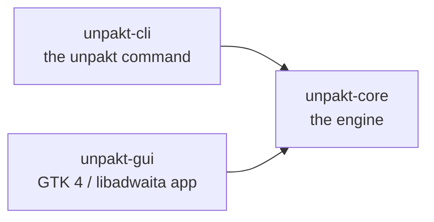
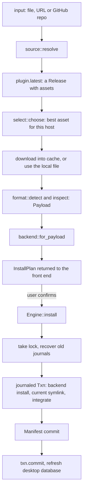
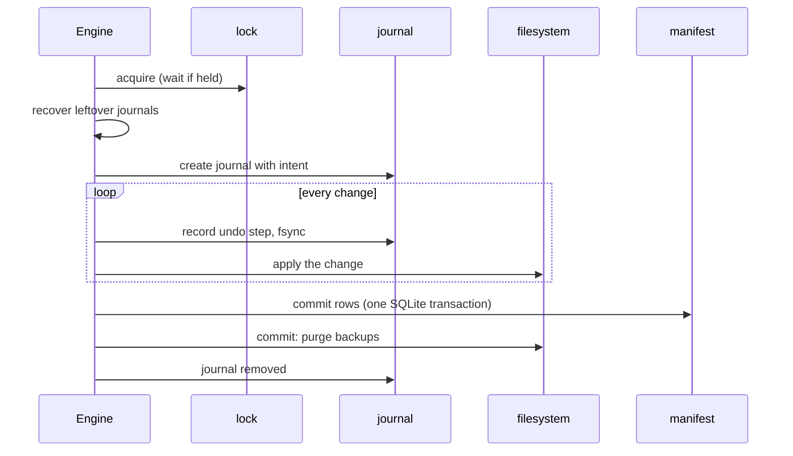
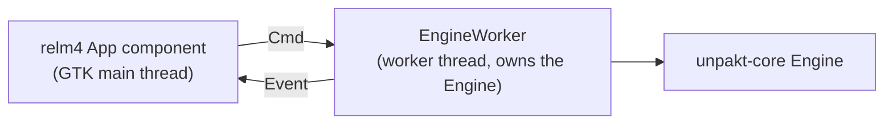

# Architecture

This is a map of the code for contributors. For how to build and test, see
[CONTRIBUTING.md](CONTRIBUTING.md).

## Crates

- `crates/unpakt-core` holds everything that touches the system: sources,
  format detection, backends, the transaction and journal, the manifest
  (SQLite), desktop integration and the `Engine` that ties them together.
- `crates/unpakt-cli` is a thin `clap` front end. It parses arguments, asks for
  confirmation, handles Ctrl-C and prints results (`main.rs`, `output.rs`).
- `crates/unpakt-gui` is a relm4 / GTK 4 / libadwaita front end over the same
  `Engine`.

The rule: `unpakt-core` has no GUI dependencies, so the CLI builds (and the
static musl binary links) without GTK. CI runs `cargo tree -p unpakt-core` and
fails if `gtk`, `glib`, `relm4` or `adw` appear.

## On-disk layout

`Layout` (`paths.rs`) maps every location from a root. The root is the home
directory, or `$UNPAKT_ROOT` when set (tests and experiments use this).

| Path under the root | Holds |
| --- | --- |
| `.local/share/unpakt/apps/<id>/<label>/` | one installed version |
| `.local/share/unpakt/apps/<id>/current` | symlink to the active `<label>` |
| `.local/share/unpakt/db.sqlite` | the manifest |
| `.local/share/unpakt/lock` | the write lock file |
| `.local/share/unpakt/journal/*.jsonl` | one journal per unfinished operation |
| `.local/share/applications/unpakt-<id>.desktop` | launcher entry |
| `.local/share/icons/hicolor/...` | icons, named `unpakt-<id>` |
| `.local/bin/<command>` | symlink (or small wrapper script) to the executable |
| `.cache/unpakt/downloads/dl-*/` | downloads; directories older than a day are swept |

The manifest (schema version 1, WAL mode) has four tables: `apps`, `versions`
(label, version, change marker, entry path, exec kind), `options` (the `--entry`
and `--pattern` an app was installed with) and `files` (every launcher, icon and
command unpakt created, so removal and update touch exactly those).

## How an install flows

`Engine::inspect` does everything up to the plan and changes nothing under the
data directory; `Engine::install` consumes the plan. A front end can therefore
show a review step in between, or drop the plan with `Engine::discard`.

1. Source resolution (`source/`). `resolve` tries three plugins in order.
   GitHub accepts `https://github.com/<owner>/<repo>` (the latest release from
   the GitHub API, with the tag as version and marker). A direct `http(s)` URL
   is a single asset, with the `ETag` or `Last-Modified` from a HEAD request as
   its marker. A local file is a single asset with no update source. Other
   github.com pages are refused. `GITHUB_TOKEN` or `GH_TOKEN` is sent to the
   API only.
2. Asset selection (`select.rs`). Names are scored: checksum and signature
   files, other operating systems and other architectures are rejected;
   `.AppImage` beats a tarball; names that mention the host architecture and
   `linux` score higher. `--pattern` filters by regex first.
3. Download (`http.rs`, `Engine::download_asset`). Streamed to a fresh `dl-*`
   directory in the cache, checking the length and polling the cancel flag.
4. Format detection (`format/`). Plugins sniff the file by magic bytes, not
   extension: an AppImage (ELF with the AppImage marker and a squashfs image,
   read in-process) or a tarball (gzip, xz, zstd, bzip2 or plain). Inspection
   reads untrusted bytes and never executes anything. The result is a
   `Payload`: name, version, entries (executables), bundled `.desktop` file
   and icon, and warnings.
5. Backend (`backend/`). `appimage-direct` copies the AppImage to
   `<id>.AppImage`. `extract` unpacks a tarball into a staging directory and
   renames it into place, refusing absolute and `..` paths.
6. Defaults (`Engine::inspect`). The app id is the slug of the name (or
   `--id`); the label is the version, or a SHA-256 prefix when the package has
   none; the entry is `--entry` or the best candidate; the command name comes
   from the bundled desktop file or the entry, falling back to the id.
7. Transaction and journal, then desktop integration and the manifest write,
   described next.

## Transactions, journal and the lock

`Txn` (`txn.rs`) is a list of filesystem changes that is undone when dropped
unless `commit()` is called. Every operation (create a directory, write a file,
rename, remove, swap a symlink) records its undo step first. Replaced or removed
files are moved aside to `.unpakt-bak-*` siblings (same filesystem, so a rename)
and purged only on commit. Long loops poll a `Cancel` flag; cancelling returns
`Error::Interrupted` and the drop undoes everything.

A journaled `Txn` also writes each undo step to `journal/<pid>-<n>.jsonl` and
syncs it before acting. The first line is the `Intent`: the app, and what its
manifest `current` must be (`Current(label)` or `Absent`) once the operation
has committed.

`lock.rs` is an exclusive file lock on `<data>/lock`. Every mutating engine call
takes it (`Engine::begin`); reads never do. If another process holds it, the
engine reports `Progress::WaitingForLock` and blocks. The OS drops the lock if
the process dies.

Crash recovery (`recover.rs`) runs under the lock at the start of every mutating
operation. For each journal it compares the manifest with the intent. If the
manifest already shows the outcome, the operation committed and only the
backups are purged. Otherwise the recorded steps are undone in reverse order.
Paths in a journal must be absolute, contain no `..` and lie inside the apps,
launcher, icon or bin directories. Anything unsafe, corrupt (other than a torn
last line) or unrecoverable stops recovery with `Error::Refused` and leaves the
file for the user. `unpakt doctor` reports journals that are still present.

## Desktop integration

`integrate.rs` and `desktop.rs` create the launcher entry, icon and command.
The bundled `.desktop` file is parsed and rewritten: `Exec` points at
`apps/<id>/current/<entry>` (keeping field codes), `Icon` becomes `unpakt-<id>`,
`X-Unpakt-Id` is added, and `DBusActivatable` and `TryExec` are dropped. Icons go
to the nearest `hicolor` size (or `scalable` for SVG). The command is a symlink
in `~/.local/bin`, or a `#!/bin/sh` wrapper for scripts and for AppImages when
FUSE 2 is missing (`APPIMAGE_EXTRACT_AND_RUN=1`). Before touching anything it
refuses when a path exists and is not owned by the app (`--force` overrides),
and when another program earlier on `PATH` would shadow the command.

## Update and rollback

`Engine::update` asks the source for the latest release and compares it with the
installed version (GitHub: tags compared by `version.rs`; direct URL: the stored
marker versus the new one; local files cannot update). If that version is
already on disk, for example after a rollback, it only switches to it. Otherwise
it re-runs `inspect` with the app's stored options, then under the lock
(`lock_unchanged` fails with a conflict if the app changed meanwhile) installs
the new version next to the old one, swaps `current`, re-integrates, prunes
versions beyond `KEEP_VERSIONS` (3), and commits. A failure leaves the old
version exactly as it was.

`Engine::rollback` points `current` at the next older version (`activate`) and
re-integrates; the launcher entry and icon stay, only what they run changes.
Nothing is deleted.

## How the GUI drives the engine

The engine blocks, so `worker.rs` runs it on a relm4 `Worker` thread. The UI
sends `Cmd` values (`Inspect`, `Install`, `Update`, `Rollback`, `Remove`, `List`,
`CheckUpdates`, `Discard`) and gets `Event` values back (`Progress`, `Inspected`,
`Installed`, `Apps`, `Updates`, `Failed`, and so on). Each long command carries a
`Cancel`; the Cancel button sets it and the engine unwinds. After every
successful mutation the worker sends a fresh app list. The model in `state.rs`
is plain data (busy state, review rows, app rows) that is tested without GTK;
`app.rs`, `apps.rs` and `review.rs` build the widgets. The app lists apps and
checks for updates at startup and when the window is focused.

## CLI behaviour worth knowing

`add` calls `inspect`, prints the plan, asks to confirm (or `--yes`), and then
`install`. The interrupt handler exits at once while nothing is being changed;
while a mutating call runs, the first Ctrl-C sets the cancel flag so the
engine undoes its work, and a second one exits immediately. Exit codes: 1 for
errors, 2 for refusals (including a declined confirmation), 130 for an
interrupt.

## Packaging and distribution

- `packaging/arch/`: `PKGBUILD` (installs both binaries, desktop file, metainfo,
  icon, licenses and completions), plus `ci-build.sh` and `ci-repo.sh`, which
  turn built packages into the `unpakt` pacman repository published on the
  `arch-repo` release (signed when a key is configured).
- `packaging/deb/`: `build.sh` and `control.in` build the `.deb` for Debian 13+ /
  Ubuntu 24.04+.
- `packaging/appimage/`: `build.sh` builds the AppImage with linuxdeploy and
  the GTK plugin (pinned by checksum); `AppRun` starts the GUI, or the CLI when
  invoked as `unpakt` or with `cli` as the first argument.
- `get.sh` is the one-command installer. It picks the pacman repository, the
  `.deb`, the AppImage or the static CLI binary for the system and checks
  downloads against `SHA256SUMS`. Its tests are in `scripts/tests`.
- The static `x86_64-unknown-linux-musl` CLI binary is built by the `musl` CI
  job.

Workflows in `.github/workflows`: `ci.yml` (lint, tests, Arch build, minimum
Rust version, musl), `packages.yml` (package builds and smoke tests),
`version-bump.yml` and `release.yml` (see CONTRIBUTING.md).
