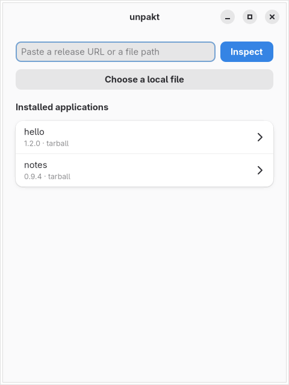

# unpakt

**Install any Linux app for your user: AppImages, tarballs, and `.deb`, `.rpm`
or pacman packages. No root, no vendor install scripts, and a one-step
rollback when an update breaks something.**

[](https://github.com/krotrn/unpakt/actions/workflows/ci.yml)
[](https://github.com/krotrn/unpakt/releases/latest)
[](#license)
[](https://krotrn.github.io/unpakt/)

```sh
unpakt add https://github.com/obsidianmd/obsidian-releases
```

That one command finds the latest release, picks the file that fits your
machine, adds the app to your applications menu and puts an `obsidian` command
on your `PATH`. Later, `unpakt update` gets the new version and
`unpakt rollback obsidian` takes you back if it misbehaves. Use it from the
terminal (`unpakt`) or from the GTK 4 / libadwaita app (`unpakt-gui`).



## Why unpakt

- **The app only ships a `.deb`, and you're on Fedora or Arch.** unpakt unpacks
  `.deb`, `.rpm` and pacman packages into your home directory, on any
  distribution, and tells you first whether the app is expected to run there.
- **You'd rather not run a vendor's install scripts as root.** unpakt never
  asks for root and never runs a package's install scripts. It reads them, and
  tells you if they would have set up accounts, services or kernel modules.
- **Your AppImages live in `~/Downloads`, with no menu entry and no updates.**
  unpakt gives each app a launcher entry with its icon, a command, and updates
  when you ask for them.
- **An update broke your app.** The last three versions stay on disk, so
  `unpakt rollback` is instant.
- **Installs that can't leave a mess.** Every install, update and removal is a
  transaction: Ctrl-C, an error or a power cut is undone on the next run.

## See before you install

`unpakt inspect` looks inside a file without running anything or changing your
system. Here it is on Obsidian's `.deb`, on an Arch machine:

```console
$ unpakt inspect ~/Downloads/obsidian_1.14.5_amd64.deb
name:    Obsidian
version: 1.14.5
id:      obsidian
source:  ~/Downloads/obsidian_1.14.5_amd64.deb
asset:   obsidian_1.14.5_amd64.deb
format:  deb -> extract
entry:   opt/Obsidian/obsidian
  other: opt/Obsidian/obsidian-cli
  other: opt/Obsidian/chrome-sandbox
  other: opt/Obsidian/chrome_crashpad_handler
command: obsidian
desktop: yes
Compatibility: ok
  note: postinst would set the setuid bit (chmod 4755 '/opt/Obsidian/chrome-sandbox' || true); it is not set
  note: postinst was not run; first unrecognized line: if type update-alternatives >/dev/null 2>&1; then
  note: postrm was not run; first unrecognized line: if type update-alternatives >/dev/null 2>&1; then
```

The [compatibility check](#compatibility-check) looked for missing libraries,
paths that won't exist outside `/opt`, system services and risky install
scripts. It found nothing that stops Obsidian from running here, and it lists
what the install scripts would have done.

## What it installs

| Format | From | How |
| --- | --- | --- |
| AppImage | file, URL, GitHub release | Run in place, or extracted where FUSE 2 is missing |
| Tarball (`.tar.gz`, `.tar.xz`, `.tar.zst`, …) | file, URL, GitHub release | Unpacked; the program and icon are found for you |
| `.deb`, `.rpm`, pacman (`.pkg.tar.zst`) | file, URL, GitHub release | Unpacked into your home after the compatibility check; scripts never run |

Given a GitHub repository, unpakt prefers an AppImage, then a tarball, then a
package for your distribution. `--format` picks one explicitly.

## Features

- Launcher entry with the app's own icon, and a command in `~/.local/bin`.
- `inspect` shows what an install would do before anything is changed.
- `update` fetches the latest release and keeps the format you installed;
  `rollback` goes back one version (the last three versions are kept).
- Transactional installs, updates and removals, with crash recovery.
- Per user only: no root, nothing written outside your home directory.
- `doctor` checks the installation for problems.
- Shell completion for bash, zsh and fish (and elvish, PowerShell).
- A desktop app with the same install, update, rollback and remove actions,
  including the compatibility verdict and its confirmations.

## Install

One command for any distribution (x86_64):

```sh
curl -fsSL https://raw.githubusercontent.com/krotrn/unpakt/main/get.sh | sh
```

It picks the package for your system: the pacman repository on Arch and its
derivatives, the release `.deb` on Debian 13+ / Ubuntu 24.04+ and theirs, and
the AppImage (with `unpakt` and `unpakt-gui` commands and a launcher entry, in
`~/.local`) everywhere else. Without a graphical session, or where the desktop
app can't run (glibc older than 2.39, musl), it installs only the static
command-line binary into `~/.local/bin`. Every download is checked against the
release's `SHA256SUMS`. Run it again to update. Options go after `sh -s --`,
e.g. `curl -fsSL … | sh -s -- --cli-only`: `--cli-only`, `--gui` (desktop app
even without a graphical session), `--source` (build from source, see
[From source](#from-source)), `--dry-run` (show what it would run).

Or install it yourself. Every release is on the
[releases page](https://github.com/krotrn/unpakt/releases); the commands below
use the version in `v`, so set it to the release you want.

```sh
v=0.1.0
```

### Arch Linux and derivatives

```sh
sudo tee -a /etc/pacman.conf >/dev/null <<'CONF'

[unpakt]
SigLevel = Optional TrustAll
Server = https://github.com/krotrn/unpakt/releases/download/arch-repo
CONF
sudo pacman -Sy unpakt          # or, once it is on the AUR: yay -S unpakt
sudo pacman -S --needed fuse2   # optional: run AppImages without extracting them
```

`SigLevel = Optional TrustAll` is for an unsigned repository. Once the
repository is signed, import its key and use the default `SigLevel`.

### Debian / Ubuntu

Ubuntu 24.04 or newer, Debian 13 or newer.

```sh
curl -fLO "https://github.com/krotrn/unpakt/releases/download/v$v/unpakt_${v}-1_amd64.deb"
sudo apt install "./unpakt_${v}-1_amd64.deb"
```

There is no apt repository yet: to update, install the newer `.deb` the same way.

### AppImage (any distribution, GUI and command line)

```sh
curl -fLO "https://github.com/krotrn/unpakt/releases/download/v$v/unpakt-$v-x86_64.AppImage"
chmod +x "unpakt-$v-x86_64.AppImage"
./unpakt-$v-x86_64.AppImage              # the GUI
./unpakt-$v-x86_64.AppImage cli --help   # the command line
```

To get an `unpakt` command, link to the AppImage under that name:
`ln -s "$PWD/unpakt-$v-x86_64.AppImage" ~/.local/bin/unpakt`. Where FUSE
isn't available (containers, some minimal systems), add
`--appimage-extract-and-run` after the file name.

### Command line only (any distribution)

A static binary with no dependencies:

```sh
curl -fLo unpakt "https://github.com/krotrn/unpakt/releases/download/v$v/unpakt-$v-x86_64-linux-musl"
install -Dm755 unpakt ~/.local/bin/unpakt
```

Or, once the crate is published on crates.io: `cargo install unpakt-cli`.

### From source

Needs Rust 1.93 or newer and the GTK 4 (4.14+) and libadwaita (1.5+)
development packages.

```sh
git clone https://github.com/krotrn/unpakt && cd unpakt
./install.sh                    # builds, then installs into /usr/local (asks for sudo)
PREFIX=~/.local ./install.sh    # or for your user only, without sudo
./install.sh --cli-only         # only the command line: no GTK packages needed
./install.sh --uninstall        # remove it again (use the same PREFIX)
```

`install.sh` installs the commands, the launcher entry, the icon and shell
completions. `get.sh --source` (`curl -fsSL … | sh -s -- --source`) installs
the build dependencies with your package manager and runs `install.sh` for the
latest release; it still needs Rust from <https://rustup.rs>.

**Runtime requirements:** the command line needs nothing extra. The GUI needs
GTK 4.14+ and libadwaita 1.5+ (the packages and the AppImage bring them). FUSE 2
is optional and lets unpakt run AppImages without extracting them.

## Upgrade

`unpakt self update` updates unpakt the same way it was installed (see
[Updating or removing unpakt itself](#updating-or-removing-unpakt-itself)).
Or by hand: `sudo pacman -Syu`, the newer `.deb`, AppImage or binary, or
`install.sh` from a newer checkout. Installed apps and their records are kept.

## Shell completion

The Arch and Debian/Ubuntu packages install completions for bash, zsh and
fish, and `get.sh` installs the bash and fish ones for your user. To install
them yourself, pick your shell (`install -D` creates the folder when it doesn't
exist yet):

```sh
unpakt completion bash | install -Dm644 /dev/stdin ~/.local/share/bash-completion/completions/unpakt
unpakt completion fish | install -Dm644 /dev/stdin ~/.config/fish/completions/unpakt.fish
unpakt completion zsh  | sudo install -Dm644 /dev/stdin /usr/local/share/zsh/site-functions/_unpakt
```

Then open a new terminal. zsh caches completions; if `unpakt <Tab>` still does
nothing, run `rm -f ~/.zcompdump*` and open another one. `unpakt completion`
also knows `elvish` and `powershell`.

## Usage

Add an app from a GitHub repository. Give the full repository URL; unpakt
installs the latest release and picks the asset that fits x86_64:

```sh
unpakt add https://github.com/owner/repo
```

From a download URL, or from a file you already have:

```sh
unpakt add https://example.com/downloads/App-1.2.3-x86_64.AppImage
unpakt add ~/Downloads/App-1.2.3-x86_64.AppImage
unpakt add ~/Downloads/app_1.2.3_amd64.deb
```

`add` shows what it is about to do and asks `Install? [y/N]`. Pass `--yes` to
skip the question (needed when there is no terminal). Useful options:
`--id`, `--command` (name of the command on `PATH`), `--no-bin`, `--desktop` /
`--no-desktop`, `--entry` (the executable inside a tarball), `--pattern REGEX`
(choose a release asset by name), `--format appimage|tarball|deb|rpm|pacman`
(only consider release assets of that format), `--allow-risky` (see
[Compatibility check](#compatibility-check)) and `--force` (replace files unpakt does not
own).

Look first, change nothing:

```sh
unpakt inspect https://github.com/owner/repo
```

See what is installed:

```sh
unpakt list          # one line per app
unpakt info <id>     # versions and every file unpakt created for the app
```

Update, roll back and remove:

```sh
unpakt update --check    # list available updates, install nothing
unpakt update            # update every app that has an update
unpakt update <id>       # update one app
unpakt rollback <id>     # switch back to the previous version
unpakt remove <id>       # remove the app and its files
```

`update` keeps the format an app was installed in: an app installed from a
`.deb` is updated from a `.deb`, even when the release also has an AppImage.
`unpakt update` also takes `--allow-risky`. Apps installed from a local file have no update source, so `update` skips
them. Check the installation:

```sh
unpakt doctor
```

`-v` shows more logging, `-vv` debug output (`RUST_LOG` overrides both):

```sh
unpakt -vv add https://github.com/owner/repo
```

### Compatibility check

Packages are built for a distribution, not for your machine. Before a package
is installed, unpakt streams through it, reads its metadata, scripts and ELF
headers, and reports a verdict. This writes nothing to disk:

- `ok`: the package is expected to run here. This is not a statement about
  whether the package is trustworthy; unpakt does not check who made it. Any
  notes (for example, that a file is setuid, which is fine where unprivileged
  user namespaces are available) are shown but do not change the verdict.
- `risky`: something may stop it from running, such as a library it needs that
  is missing, a hardcoded system path that will not exist, files that belong
  in system directories (services, udev rules, kernel modules), a setuid file
  or a script that sets the setuid bit when unprivileged user namespaces are
  unavailable, or an install script that sets up accounts, capabilities or
  kernel settings (`useradd`, `setcap`, `sysctl`, `dkms` and the like).
  `add` and `update` refuse a risky package with exit status 2. Pass
  `--allow-risky` (in the app: Install anyway or Update anyway) to install it
  anyway; the reasons you accepted are remembered for that app, and a later
  update stops again only when a new reason appears.
- `needs-container`: the package needs newer system libraries (for example
  glibc) than this machine has, which a per-user install cannot provide. There
  is no override.

`unpakt inspect <file>` prints the verdict without installing anything.

Install scripts (`postinst`, `%post`, `.INSTALL`) are never run. unpakt reads
them as text. Lines it does not recognise are shown as notes, and only
account, capability and kernel setup commands (`useradd`, `setcap`, `sysctl`,
`modprobe`, `dkms` and the like) make a package risky. A package that needs its
script to do something beyond that will not have had it done.

Some vendors ship a launcher script that looks for its files under
`/usr/share/<app>` or `/opt/<app>`. unpakt does not rewrite vendor files, so
such a package comes out risky with the path named. When the vendor also offers
a tarball, install that instead: Discord's deb is refused this way, while its
tar.gz works, because its launcher also looks next to itself.

Installing system-wide, through the package manager, comes in a later release.

### Where files go

| What | Where |
| --- | --- |
| Installed apps | `~/.local/share/unpakt/apps/<id>/<version>/`, with `current` pointing at the active one |
| Database | `~/.local/share/unpakt/db.sqlite` |
| Launcher entries | `~/.local/share/applications/unpakt-<id>.desktop` |
| Icons | `~/.local/share/icons/hicolor/` |
| Commands | `~/.local/bin/<command>` |
| Downloads (temporary) | `~/.cache/unpakt/downloads/` |

Make sure `~/.local/bin` is on your `PATH`; `unpakt doctor` tells you if it
is not. Set `UNPAKT_ROOT` to a directory to use it in place of your home
directory, for example to try unpakt without touching your real setup:

```sh
UNPAKT_ROOT=/tmp/try unpakt list
```

### Updating or removing unpakt itself

`unpakt self update` updates unpakt the way it was installed: through the
package manager, as an AppImage, as the static binary, or with `install.sh`
(it rebuilds from the new release's source). `unpakt self update --check` only
checks for a newer version. `unpakt self uninstall` removes unpakt; add
`--purge` to also remove the apps it installed and unpakt's own data. Both ask
before running anything with sudo; `--yes` skips the question. For `cargo
install`, use cargo: `cargo install --locked unpakt-cli` or `cargo uninstall
unpakt-cli`.

## Troubleshooting

**An AppImage does not start, or `doctor` reports `fuse2` as not found.**
AppImages normally need FUSE 2 (`libfuse.so.2`). When unpakt does not find it,
it installs the app so that it runs with `APPIMAGE_EXTRACT_AND_RUN=1`, which
extracts the AppImage on each start instead. Installing the FUSE 2 package
(`fuse2` on Arch, `libfuse2t64` on Ubuntu 24.04) makes apps start faster. To run
an AppImage by hand without FUSE, use `APPIMAGE_EXTRACT_AND_RUN=1 ./App.AppImage`
or pass `--appimage-extract-and-run`.

**The command is not found after installing.** The command goes to
`~/.local/bin`, which must be on your `PATH`. Add it in your shell profile and
open a new terminal. `unpakt doctor` shows `bin-in-path` as `[!!]` when it is
missing.

**`conflict: ... would be shadowed by ...`.** Another program of the same name
sits earlier on your `PATH`. Choose a different name with `--command`, skip the
command with `--no-bin`, or use `--force`. The GUI offers to install without the
command.

**`conflict: ... already exists and is not managed by unpakt`.** unpakt will not
overwrite files it did not create. Move the file away, or pass `--force`.

**`no release asset matches this host`.** The release has no AppImage,
tarball or package for x86_64 Linux (unpakt skips other systems and architectures,
checksums and signatures). The message lists the asset names it saw. If one of
them is right but scores lower than another, select it with `--pattern`:

```sh
unpakt add https://github.com/owner/repo --pattern 'x86_64.*\.AppImage$'
```

**`http error: ... status 403` from GitHub.** Unauthenticated GitHub API
requests are rate limited. Set `GITHUB_TOKEN` (or `GH_TOKEN`) to a personal
access token; unpakt then sends it to the GitHub API, and never to download
URLs.

**An install or update was interrupted (power loss, killed process).** Nothing
to do: the next command that changes anything (`add`, `update`, `rollback`,
`remove`) first undoes the half-finished change, or finishes cleaning up after
one that had committed. If a recovery journal cannot be processed safely,
the command stops with `cannot recover the unfinished operation recorded in
<file>`, and `unpakt doctor` lists the file under `journal`. Look at the file,
fix or delete it, then retry.

**`waiting for another unpakt operation to finish...`.** Only one unpakt
changes things at a time (the CLI and the GUI share one lock). The command
waits and then continues. If nothing else is running, check for a stuck
`unpakt` process. The lock is released automatically when a process dies.

**A package is refused as risky (exit status 2).** Read the reasons that
`add` or `inspect` prints. If you accept them, run again with `--allow-risky`.
A `needs-container` package cannot be installed.

**`refusing to install without confirmation; pass --yes`.** `add` and `remove`
ask on the terminal; without one they refuse unless you pass `--yes`.

**`unsupported: ...`.** unpakt installs AppImages, tarballs and deb, rpm and
pacman packages. A `.zip` or a bare executable is refused.

## FAQ

**Why per user, with no root?** Installing into your home directory needs no
privileges, cannot break the system's packages, and lets each user have their
own apps. Everything unpakt writes is under `~/.local` and `~/.cache`.

**Is installing a `.deb` with unpakt the same as `apt install`?** No. unpakt
unpacks the package's files into your home directory, rewrites its links to
point there, and never runs its install scripts or resolves its dependencies.
That suits self-contained apps, which is most vendor packages (VS Code, Slack,
Obsidian and the like). A package that needs a system service, a new user
account or a kernel module comes out `risky` and is refused unless you accept
it; one that needs newer system libraries than you have is refused outright.

**Will a package built for another distribution work?** Often, for
self-contained apps. `unpakt inspect` tells you before anything is installed:
it checks every library the program needs against your system.

**Where are my apps stored?** See [Where files go](#where-files-go).
`unpakt info <id>` lists every file created for one app.

**Does unpakt verify the apps' signatures?** No. It does not check checksums
or signatures of the apps it installs yet; see
[Known limitations](#known-limitations). Install apps from sources you trust.

**Does it update apps in the background?** No. Run `unpakt update` (or
`unpakt update --check`), or use the update action in the GUI.

**How many versions are kept?** The last three versions of each app. `rollback`
switches to the next older one.

**What happens to my apps if I uninstall unpakt?** Removing the package or the
binary leaves `~/.local/share/unpakt`, the launchers and the commands in
place, so the installed apps keep starting. You just cannot update or remove
them with unpakt until you install it again. `unpakt self uninstall --purge`
removes the apps as well.

**How does `update` know there is a new version?** For a GitHub repo it
compares the latest release tag with the installed one. For a download URL it
compares the server's `ETag` or `Last-Modified` header. Apps installed from a
local file cannot be updated.

## Compared with other tools

Short and incomplete; each tool has its strengths.

| Tool | What it is | How unpakt differs |
| --- | --- | --- |
| AppImageLauncher | Integrates AppImages into the desktop when you open them | unpakt is a command-line-first installer with updates from GitHub releases and rollback; it also installs tarballs and packages |
| Gear Lever | GUI manager for AppImages | unpakt has a CLI as well as a GUI, and installs tarballs and packages |
| AM / appman | A large script-based catalogue of portable apps | unpakt has no catalogue: you point it at a repo, URL or file |
| eget, bin | Download a release binary from GitHub | unpakt also creates launcher entries and icons, keeps versions and can roll back |
| `dpkg -x`, `rpm2cpio`, `bsdtar` by hand | Unpack a package's files | unpakt also checks that the app can run, fixes its links and paths, adds a launcher and a command, and can update and roll back |
| distrobox | Runs another distribution in a container | unpakt unpacks the package straight into your home without a container, and tells you when an app does need one |

## Contributing

Bug reports and patches are welcome. See
[CONTRIBUTING.md](https://github.com/krotrn/unpakt/blob/main/CONTRIBUTING.md)
for setup and checks, and
[ARCHITECTURE.md](https://github.com/krotrn/unpakt/blob/main/ARCHITECTURE.md)
for how the code is organised. Documentation: <https://krotrn.github.io/unpakt/>.

## Verify a download

```sh
sha256sum -c SHA256SUMS --ignore-missing
gh attestation verify <file> -R krotrn/unpakt
minisign -Vm SHA256SUMS -P <key>   # when SHA256SUMS.minisig is published
```

This verifies unpakt's own release files, not the apps unpakt installs (see
[Known limitations](#known-limitations)). The minisign public key will be
published with the release and in this README once signing is enabled; until
then a release has no `SHA256SUMS.minisig`.

## Known limitations

- unpakt does not verify checksums or signatures of the apps it installs yet.
- unpakt does not check for updates in the background yet; run `unpakt update`.
- Packages are unpacked, not installed through your package manager: their
  dependencies are not installed and their install scripts never run. Apps
  that need either are flagged by the compatibility check.
- Some vendors ship a `.deb` that is only a launcher looking for files under
  `/usr/share` or `/opt`; use their tarball instead (see
  [Compatibility check](#compatibility-check)).
- x86_64 only.

## License

Licensed under either of [Apache License, Version 2.0](LICENSE-APACHE) or
[MIT license](LICENSE-MIT) at your option.
